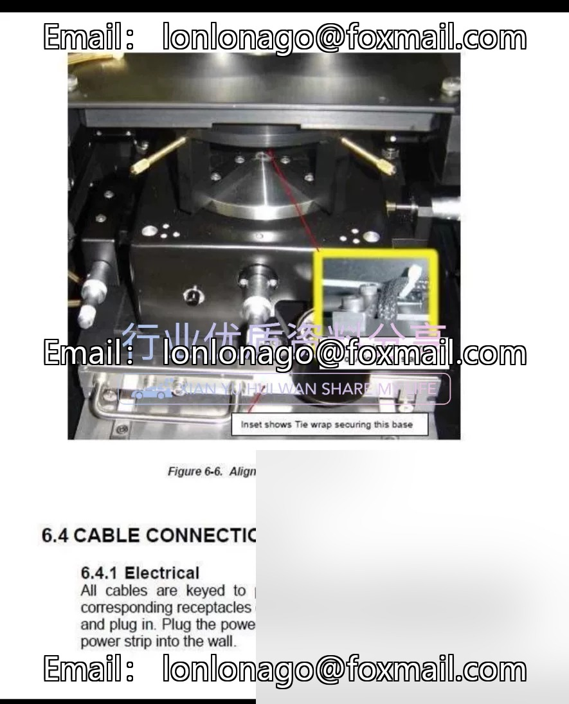
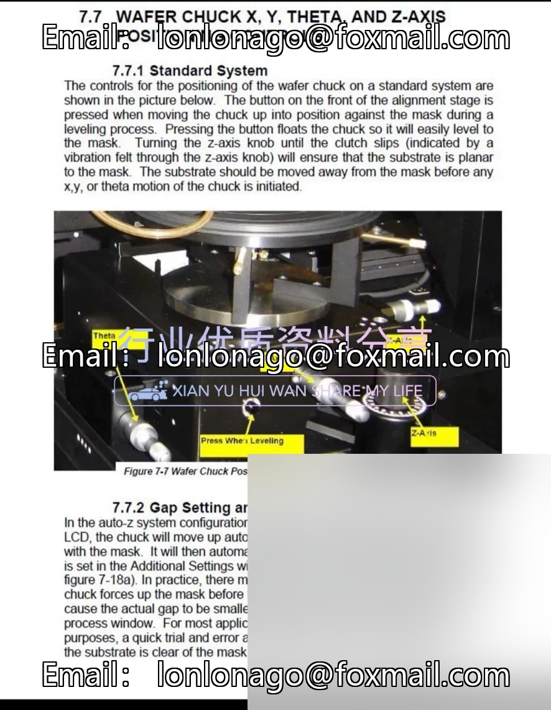
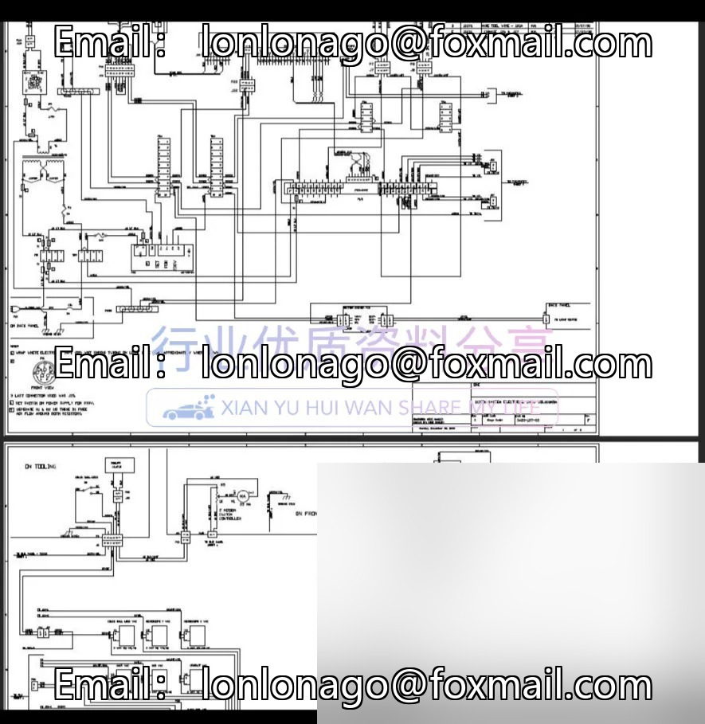
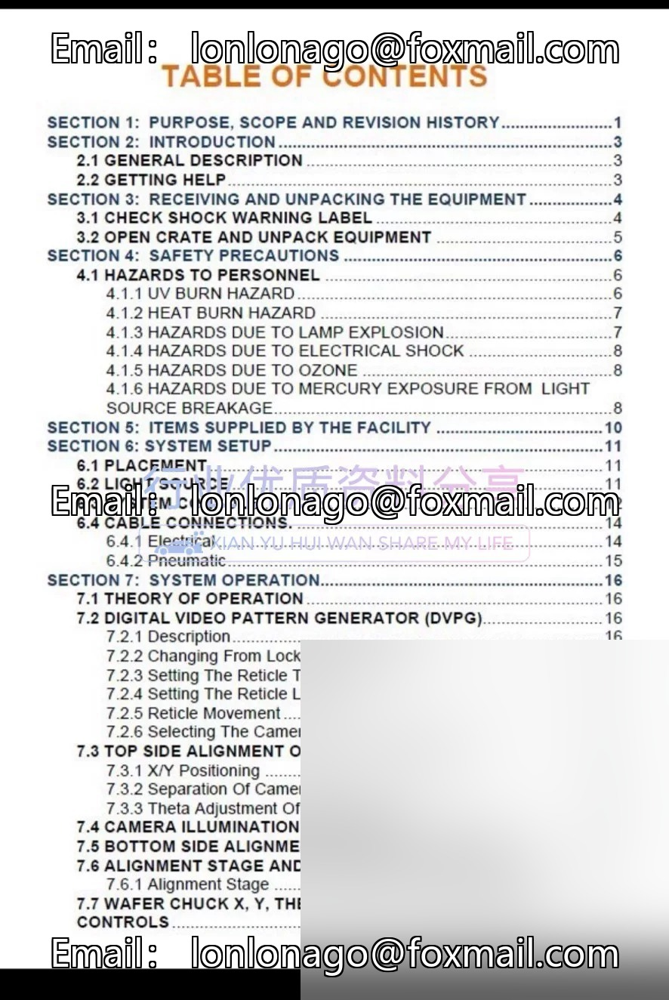
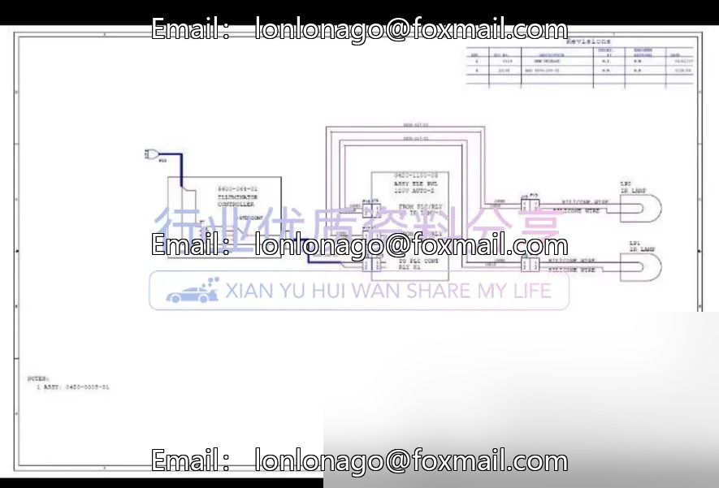
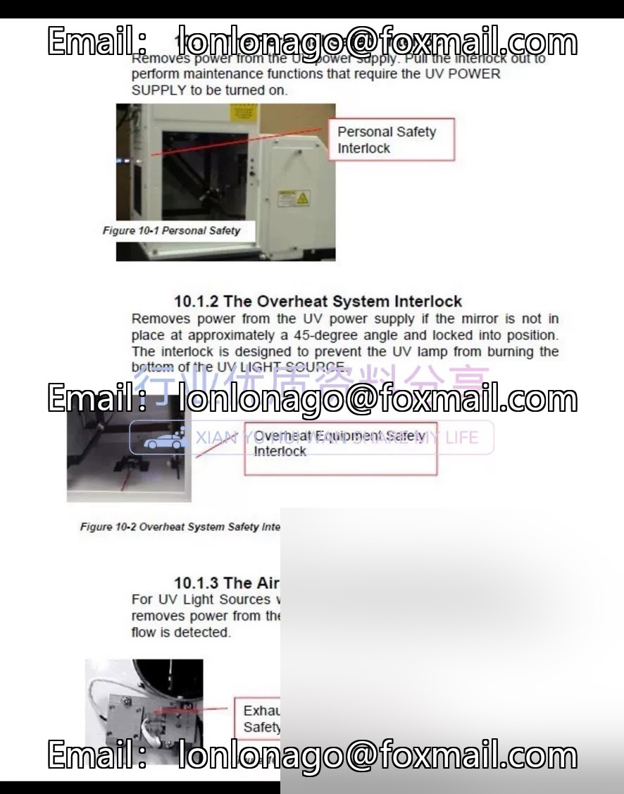

# American OAI Model 800MBA dual-side exposure machine / semi-automated photolithography

## Body

American OAI Model 800MBA double-sided exposure machine / semi-automated photolithography machine electronic technical data, with comprehensive content including equipment structure descriptions, operation methods and circuit diagrams, large reference value.

Upload directly to for electronic original files! The following image contains a screenshot of the file portion. Please confirm before placing an order! Because electronic file materials are copyable. So after purchase, no return is allowed! Thank you for understanding!

For personal learning and reference use only.

The data covers the US OAI Model 800MBA dual-side exposure machine and semi-automatic lithography machine, including device structure, operation methods and circuit diagrams; the images show industry-quality materials, positioning controls and cable connection details.

<!-- AI_ENRICHED -->

## Images

## Payment

Here is a pay link on Stripe ( https://buy.stripe.com/3cs8yP7sY87d0vu9AB ). Please contact me lonlonago@foxmail.com after funding $89, and I will send you a complete data files , thank you!

